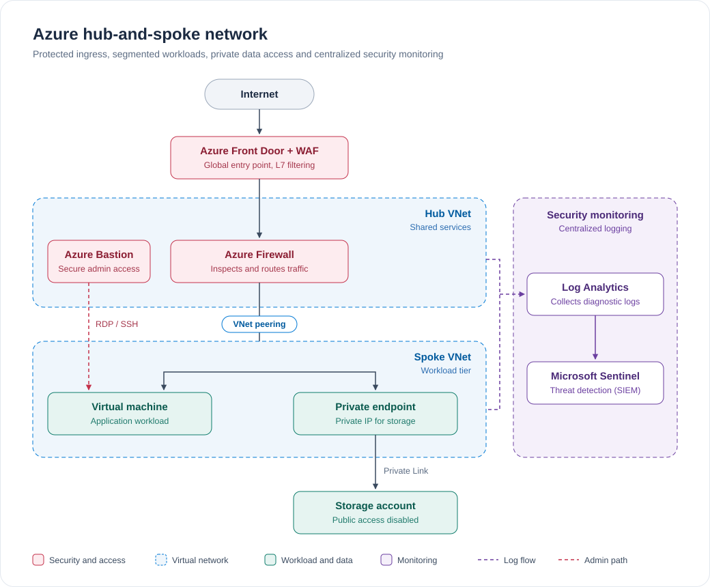

# Azure Secure Enterprise Zone
Hands-on Azure cloud platform project covering hub-and-spoke networking, Entra ID, Defender for Cloud, Sentinel, Terraform, and planned GitHub Actions automation.

## Overview
---
This Azure enterprise-platform project brings networking, identity, compute, storage, security, monitoring, and infrastructure as code into one connected environment. The project demonstrates how these layers support each other rather than presenting them as unrelated exercises.

## Problem
---
Swpype, a New York-based finance firm, need to establish an Azure foundation for internal workloads as they begin to expand across the tri-state area through a number of acquisitions. 

## Solution
--- 
We are to:
- Separate shared connectivity from workload resources 
- Organize access through identity groups
- Configure private storage connectivity
- Create a central place to review operational and security information. 

This document describes accomplishments recorded in my repository as of October 21, 2026. Its evidence consists of documented Azure portal observations, earlier owner-supplied assessments, my deployment confirmation, and repository code. It is not a fresh live-Azure audit.

## Architecture at a glance

My environment uses one hub virtual network and one spoke virtual network in East US. The hub organizes shared networking and management space; the spoke contains the Windows Server VM and private storage endpoint. Four resource groups separate networking, workloads, security, and monitoring.

| Area | Project resources |
| --- | --- |
| Shared networking | gtg-hub-prod; vnet-hub-prod, 10.0.0.0/16 |
| Workloads | gtg-spoke-prod; vnet-spoke-prod, 10.1.0.0/16; Windows Server VM; storage account |
| Security | gtg-security-prod; Azure Key Vault |
| Monitoring | gtg-monitoring-prod; Log Analytics workspace with Microsoft Sentinel enabled |
| Access management | Microsoft Entra ID groups and Azure role assignments |
| Infrastructure code | Terraform definitions for the four resource groups and shared tags |

Repository architecture diagram

## 1. Network architecture
### What I achieved

- Established a hub-and-spoke layout using vnet-hub-prod and vnet-spoke-prod, with connected peering configured in both directions according to the recorded assessment. Peering is the connection that allows the two private networks to communicate.
- Separated address space between the hub, 10.0.0.0/16, and spoke, 10.1.0.0/16.
- Created dedicated hub subnet space for management, 10.0.1.0/24, and reserved service subnets named AzureBastionSubnet, 10.0.2.0/26, and AzureFirewallSubnet, 10.0.3.0/26. These are subnet-creation accomplishments, not claims that the named services were deployed.
- Attached nsg-servers-prod to the server subnet. A network security group, or NSG, is a set of traffic rules applied to a network boundary.
- Configured the allow-rdp-from-hub rule to permit TCP port 3389 from the hub address range at priority 100. This describes the rule I created, not an assertion that all other RDP sources are blocked.

### Why this matters

The design gives shared connectivity and workload hosting distinct places in the environment. Network layout, subnet organization, and traffic rules can be explained together as a single architecture instead of separate configuration tasks.

### How I explain it in an interview

“I built a hub-and-spoke network with separate address ranges and bidirectional peering. I organized management and workload space into dedicated subnets and applied a server-subnet NSG with an explicit RDP allow rule for the hub.”

## 2. Identity and access
### What I achieved

- Configured Microsoft Entra ID groups named Azure-Admins, Azure-Readers, and Azure-Security.
- Assigned subscription Contributor to Azure-Admins.
- Configured eligible, time-bound Reader access for Azure-Readers and eligible, time-bound Security Reader access for Azure-Security, as recorded in the project review. These statements describe the assignments, not completed user activations.
- Reviewed a successful Azure Resource Manager sign-in showing Security Defaults enabled and the multifactor-authentication requirement satisfied. This is evidence from the sampled sign-in, not a claim that I deployed a custom Conditional Access policy.
- Documented group membership, group ownership, and role assignments as separate parts of the access model.

### Why this matters

Identity answers who can act; role-based access control, or RBAC, answers what they can do and where. Group-based assignments organize permissions around responsibilities such as administration, read-only review, and security review.

### How I explain it in an interview

“I organized Azure access around Entra ID groups and assigned different roles for administration, general reading, and security review. I also reviewed authentication evidence showing that an MFA requirement was satisfied.”

## 3. Compute and workload hosting
### What I achieved

- Deployed vm-admin-prod-01, a Windows Server virtual machine, in gtg-spoke-prod in East US.
- Placed the VM in vnet-spoke-prod/snet-servers with private IP address 10.1.1.4.
- Established a VM configuration with no public IP displayed in the reviewed evidence.
- Recorded its Generation V2, x64 configuration and reviewed size of 1 vCPU and 2 GiB RAM.
- Captured the VM's stopped/deallocated state in the project snapshot.

### Why this matters

The VM connects the network design to a real compute resource. This accomplishment is the Windows Server hosting foundation; it does not claim the video's two-Ubuntu-VM web application and database deployment.

### How I explain it in an interview

“I deployed a Windows Server VM inside the workload spoke, assigned it a private network address, and reviewed its placement and configuration without giving it a public IP.”

## 4. Storage and private connectivity
### What I achieved

- Deployed the StorageV2 account stsecureplatprod in gtg-spoke-prod.
- Disabled the storage account's public network access.
- Configured the Blob private endpoint pe-stsecureplatprod in the spoke's snet-private-endpoints subnet, using private IP 10.1.2.4. The reviewed endpoint showed Succeeded and Approved.
- Associated the endpoint with the private DNS zone privatelink.blob.core.windows.net and zone group default.
- Configured a completed private DNS zone link to vnet-spoke-prod and reviewed the displayed hostname-to-private-IP mapping. DNS is the naming system that translates a service name into an address.

### Why this matters

These settings connect the storage service to the private network design and disable its public network entry point. The accomplishment is the endpoint and DNS configuration observed in Azure, not a claim of a completed client data-transfer test.

### How I explain it in an interview

“I configured Blob Storage with public network access disabled, an approved private endpoint in the workload spoke, and a private DNS zone linked to that spoke.”

## 5. Security services and posture assessment
### What I achieved

- Deployed kv-security-prod01, a Standard-tier Azure Key Vault, in gtg-security-prod.
- Configured the vault to use the Azure RBAC permission model and confirmed soft delete was enabled.
- Enabled and reviewed Defender for Cloud foundational security-posture assessment for the project subscription.
- Reviewed a recorded Secure Score of 46%, 21 assessed resources, and 24 recommendations. These are historical assessment figures, not current live measurements or a compliance certification.
- Examined the Microsoft cloud security benchmark view separately from Secure Score, recording 47 of 63 controls passed in that view.

### Why this matters

Key Vault adds a dedicated security resource to the platform. Defender for Cloud adds a way to inspect configuration posture and discuss specific findings, rather than treating deployment alone as proof that an environment is secure.

### How I explain it in an interview

“I deployed Key Vault using Azure RBAC and reviewed Defender for Cloud's posture assessment. I can explain the recorded Secure Score and recommendations as assessment results rather than present them as proof of complete protection.”

## 6. Monitoring and operational visibility
### What I achieved

- Created law-monitoring-prod in gtg-monitoring-prod as the central Log Analytics workspace.
- Reviewed enabled diagnostic-setting entries for the storage-account parent resource, Key Vault, and the workspace.
- Inspected a diagnostic setting named gtg-AllAzure that selected allLogs and AllMetrics and targeted law-monitoring-prod.
- Built and executed Kusto Query Language, or KQL, queries to explore AzureActivity records. Query history recorded nonzero results on October 2–3, 2026.
- Created an enabled activity-log alert named StorageAccountsWatchRule, configured for Administrative events and a storage-account target type. This records alert-rule configuration rather than tested notification delivery.

### Why this matters

The workspace provides a central location for log analysis. KQL adds a practical way to investigate recorded activity, while the configured alert demonstrates how selected administrative events can be represented as an operational monitoring rule.

### How I explain it in an interview

“I established a Log Analytics workspace, reviewed diagnostic settings, queried Azure activity records with KQL, and configured an activity-log alert for storage-account administration.”

## 7. Security operations
### What I achieved

- Enabled Microsoft Sentinel on the project workspace law-monitoring-prod.
- Reviewed the Sentinel overview showing two active connectors and zero unhealthy connectors in the displayed snapshot.
- Established Sentinel as the security-operations component associated with the project's central logging workspace.

### Why this matters

This connects operational logging with a dedicated security-analysis platform. It gives the project a security-operations foundation alongside its networking, identity, and resource-management layers.

### How I explain it in an interview

“I enabled Sentinel on the project's Log Analytics workspace and reviewed the connector status as part of establishing the security-operations foundation.”

## 8. Infrastructure as code
### What I achieved

- Used Terraform for core-infrastructure deployment, as confirmed in the October 21 project review.
- Committed Terraform configuration defining the four resource groups: gtg-hub-prod, gtg-spoke-prod, gtg-security-prod, and gtg-monitoring-prod.
- Defined shared tags once in local.common_tags and referenced that common map from each resource-group definition.
- Recorded Environment, Owner, Project, ManagedBy, and CostCenter in the common tag configuration.
- Kept the resource-group configuration in GitHub so the declared foundation can be read and reviewed as code.

### Why this matters

Terraform expresses infrastructure as text instead of relying solely on portal actions. The committed main.tf provides concrete evidence of resource-group and tag definitions; the scope of this code claim is those definitions, not the entire deployed architecture or a CI/CD pipeline.

### How I explain it in an interview

“I used Terraform for my core infrastructure and committed the four resource-group definitions with a shared tagging map. The code makes that foundation explicit and reviewable.”

## 9. Governance and resource organization
### What I achieved

- Organized resources into distinct networking, workload, security, and monitoring resource groups.
- Established the gtg-<function>-prod resource-group naming pattern and documented naming standards.
- Applied resource-group tags for CostCenter, Environment, ManagedBy, Owner, and Project.
- Configured a subscription policy requiring the Environment tag on resource groups, with enforcement enabled according to the recorded assessment.
- Maintained supporting documentation for networking, identity, compute, storage, security, monitoring, naming, and tagging in the repository.

### Why this matters

Naming makes resource purpose easier to recognize. Tags attach ownership and business context. Policy adds an enforceable organization rule rather than relying entirely on someone remembering the naming and tagging guide. CostCenter tagging supplies organizational context; it is not a claim of measured savings or a deployed cost dashboard.

### How I explain it in an interview

“I organized the platform into functional resource groups, documented naming and tagging standards, and configured a policy requiring an Environment tag on resource groups.”

## How the accomplishments connect

The resource-group structure organizes the platform. The hub and spoke establish network boundaries and connectivity. The Windows Server VM occupies the workload network, while the storage private endpoint and DNS configuration connect a data service to that private layout.

Entra ID groups and role assignments organize access to Azure resources. Key Vault adds a dedicated security service, while Defender for Cloud supplies posture-assessment information. Log Analytics, KQL, the configured alert, and Sentinel establish complementary operational and security visibility. Terraform captures the resource-group foundation and common tags in code.

Together, these accomplishments give me one connected project to discuss across cloud administration, networking, access management, security assessment, monitoring, and infrastructure as code.

## Evidence links

- Project repository and recorded October 21 assessment — the README source contains the detailed assessment, including content stored inside HTML comments.
- Terraform resource-group definitions and common tags
- Supporting project documentation
- Video used to structure the companion document

Evidence note: the links above track the repository's main branch and may change after this snapshot. Historical metrics and configuration observations in this document refer to the recorded project review, not continuous verification.